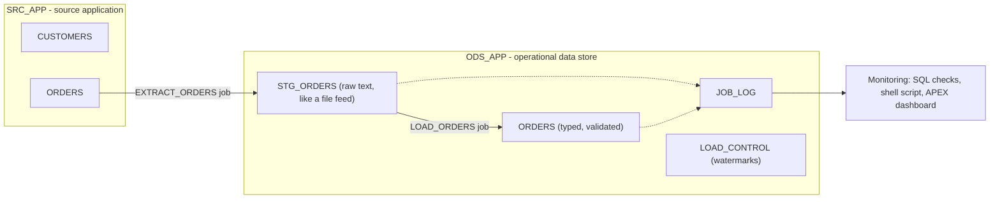

# Mini ODS — Data Operations Support Lab

A hands-on lab that simulates the daily work of an **L2 application / data operations support** specialist.
A source application feeds an **Operational Data Store (ODS)** through scheduled jobs, and the jobs fail.
Each failure is detected, analysed, reprocessed and documented the same way it is done in production support.

> **Status:** work in progress. See [Roadmap](#roadmap).

## Architecture



## Tech stack

| Area | Tools |
|---|---|
| Database | Oracle AI Database 26ai Free (container), SQL, PL/SQL |
| Scheduling | `DBMS_SCHEDULER` |
| Environment | Docker Compose |
| Linux / automation | Bash, `grep`, cron (WSL Ubuntu) |
| UI | Oracle APEX (apex.oracle.com workspace) |
| CI | GitHub Actions |

## Quick start (Windows PowerShell)

```powershell
# 1. Create your local secrets file and change the passwords
Copy-Item .env.example .env

# 2. Start the database (the first start downloads the image)
docker compose up -d

# 3. Follow the log until you see: DATABASE IS READY TO USE!
docker logs -f mini-ods-db

# 4. Container should be (healthy)
docker compose ps
```

### Smoke test

```powershell
docker exec -it mini-ods-db sqlplus ods_app/<ODS_APP_PASSWORD>@localhost/FREEPDB1
```

```sql
SELECT COUNT(*) FROM src_app.orders;            -- expected: 200
SELECT job_name, last_success_at FROM load_control;  -- expected: 2 rows
```

### Connect from VS Code (SQL Developer extension)

| Field | Value |
|---|---|
| Host | `localhost` |
| Port | `1521` |
| Type | Service name |
| Service name | `FREEPDB1` |
| User | `ods_app` (or `src_app`) |

### Reset the lab

```powershell
docker compose down -v   # deletes the data volume; init scripts run again on next "up"
```

## Project structure

```
db/init/         one-time setup: users, schemas, seed data (runs on first start)
db/ods/          extract and load procedures, scheduler jobs
monitoring/      support queries: failed, stuck and missing runs, reconciliation
scripts/         shell automation (health checks, reprocessing)
docs/runbooks/   step-by-step procedures for known issues
docs/incidents/  incident reports from simulated failures
```

## Roadmap

| # | Status | Step | Real support task it simulates |
|---|---|---|---|
| 1 | ⬜ | Environment: Oracle Free in Docker, schemas, seed data | environment management |
| 2 | ⬜ | `EXTRACT_ORDERS`: copy changed orders into staging | data pump from a source system |
| 3 | ⬜ | `LOAD_ORDERS`: validate, load to target, log every run | batch processing |
| 4 | ⬜ | Schedule both jobs with `DBMS_SCHEDULER` | job scheduling |
| 5 | ⬜ | Monitoring queries: failed, stuck and missing runs, row-count reconciliation | monitoring |
| 6 | ⬜ | Failure scenarios: bad data, duplicates, locked account, full tablespace | incident simulation |
| 7 | ⬜ | Reprocessing procedure and verification | incident resolution |
| 8 | ⬜ | `check_jobs.sh` health check scheduled with cron | automation, Linux |
| 9 | ⬜ | Planned outage drill: stop, start, post-checks | DR test, patching support |
| 10 | ⬜ | Read-only support account | access management |
| 11 | ⬜ | Runbooks and incident reports | incident and problem management |
| 12 | ⬜ | APEX monitoring dashboard | Oracle APEX |
| 13 | ⬜ | GitHub Actions: start Oracle and run smoke tests on every push | CI/CD |
| 14 | ⬜ | AI triage helper: error and log context in, category and runbook step out | AI in operations |

## Troubleshooting

| Symptom | Cause | Fix |
|---|---|---|
| `$'\r': command not found` in the log | Windows line endings in a `.sh` file | Save the file with LF (VS Code: bottom right `CRLF` -> `LF`), then reset the lab |
| `port is already allocated` | Something else uses port 1521 | Stop the other database or change the port to `"1522:1521"` |
| Init script changes have no effect | Init scripts only run when the database is created | `docker compose down -v`, then `docker compose up -d` |
| `ORA-01017: invalid credential` | Wrong password or `.env` was missing on the first start | Check `.env`, reset the lab |
